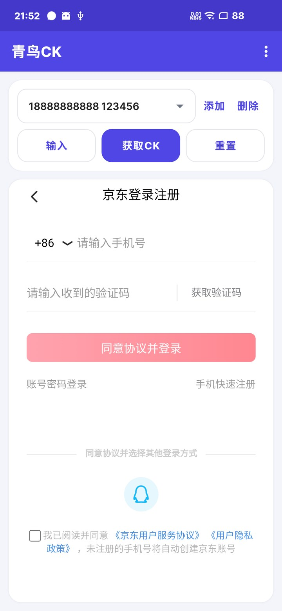
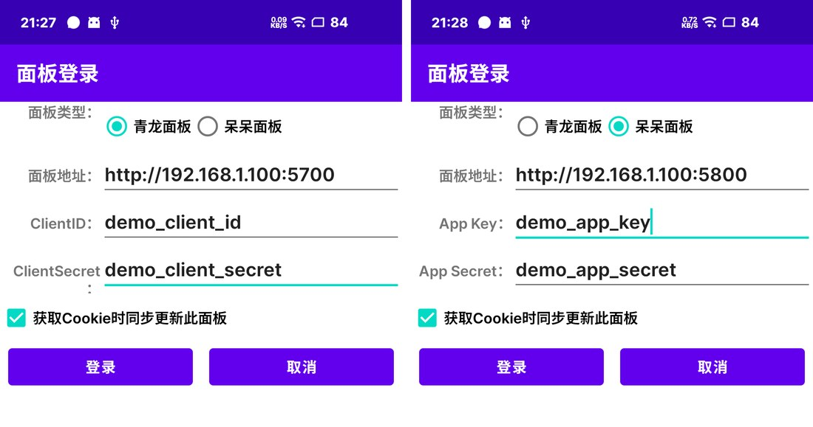

# 青鸟CK - 京东 Cookie 助手（青龙 / 呆呆面板）

## PC版
[JD_Get](https://github.com/yclown/ql_jd_cookie)

## 说明
v2.5.1
青鸟CK 用于从青龙面板、呆呆面板获取京东 Cookie，支持双面板同步更新。安装包可在 [Releases](https://github.com/reason195/jdck-android/releases) 下载，发布标题为「青鸟CK 版本号」，文件名为 `Qingniao-CK-版本号.apk`（GitHub 不支持中文资产名）。

原项目 地址(https://github.com/XanderYe/jdck-android) 项目作者没有更新，就接过来自己更了

## 优化
* 全新的 Material 界面与青鸟应用图标，设置页超长地址、ClientSecret、App Secret 自动换行完整显示
* 修复青龙面板更新 Cookie 时重复新增环境变量（兼容新版 `id` 与旧版 `_id`），已有环境变量保留自定义备注
* 添加账号弹窗改为圆角，按钮增加水波纹与按压缩放反馈
* 支持青龙面板和呆呆面板（登录页选择面板类型）
* 支持同时配置青龙与呆呆两个面板，获取 Cookie 后同步更新所有已启用的面板
* 修改青龙面板的对应的接口地址
* 使用ClientID和ClientSecret进行接口对接
* 自动启用更新后的环境变量

## 功能
* 保存/删除手机号
* 一键输入手机号并打勾协议
* 一键复制cookie
* 清空cookie并重新加载
* 支持青龙面板登录及更新cookie
* 支持呆呆面板登录及更新cookie（令牌过期自动重新登录）
* 支持青龙、呆呆两个面板同时更新，单个面板失败不影响另一个
* 支持短信验证码自动识别

### 账号密码输入说明
* 点击「添加」，分别填写京东账号（手机号）和密码，密码可以留空
* 保存后下拉框会显示「账号 + 密码」，点「输入」可一键带入
* 需要先手动切换到账号密码登录页
* 填写了密码的账号会自动点击登录按钮

## 面板对接

点击右上角菜单「面板设置」。两个面板的配置相互独立，可以只配置一个，也可以两个都配置：

1. 选择「青龙面板」或「呆呆面板」，填写地址和凭据。
2. 勾选「获取Cookie时同步更新此面板」（默认勾选），点击「登录」保存。
3. 切换到另一种面板类型，重复上述步骤，即可同时启用两个面板。
4. 之后获取 CK 时会依次更新所有已启用的面板，并分别提示结果；某个面板失败不会影响另一个。

### 青龙面板
* 面板地址：`http://ip:5700`
* 凭据：`ClientID` / `ClientSecret`

### 呆呆面板
1. 在呆呆面板网页端进入「Open API」，新建应用，权限范围勾选「环境变量」（或选择全部权限）。
2. 在 App 的「面板设置」中选择「呆呆面板」，填写面板地址、`App Key`、`App Secret`，勾选启用后登录。
3. 获取 CK 后，App 会通过 Open API 新增或更新 `JD_COOKIE` 环境变量，并自动启用。

> 呆呆面板接口依据 [daidai-panel](https://github.com/linzixuanzz/daidai-panel) v3.3.9 的 `/api/v1/open-api/token` 与 `/api/v1/envs` 实现，应用令牌有效期 24 小时，过期后 App 会使用保存的 App Key / App Secret 自动重新登录。

## 界面展示

主界面：保存「账号 + 密码」后可在下拉框直接选择，点「输入」一键带入登录。

面板设置：青龙 / 呆呆两个面板分别配置，可单独或同时启用，获取 CK 后同步更新。

